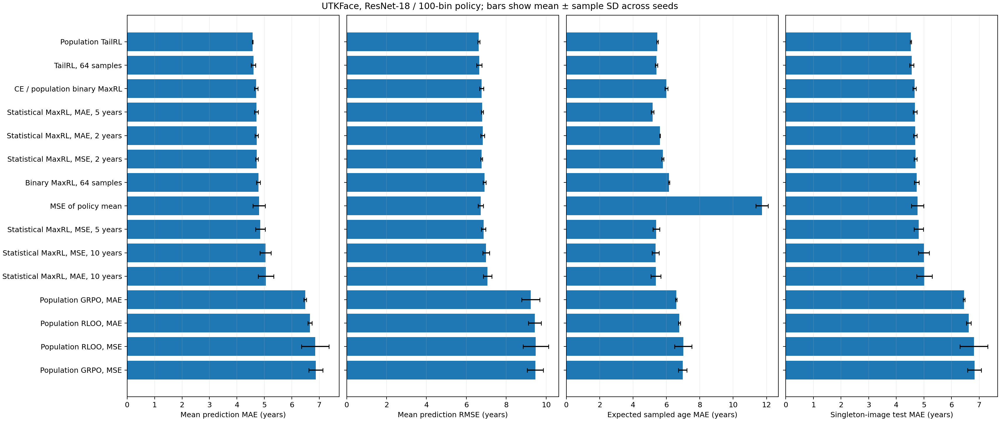
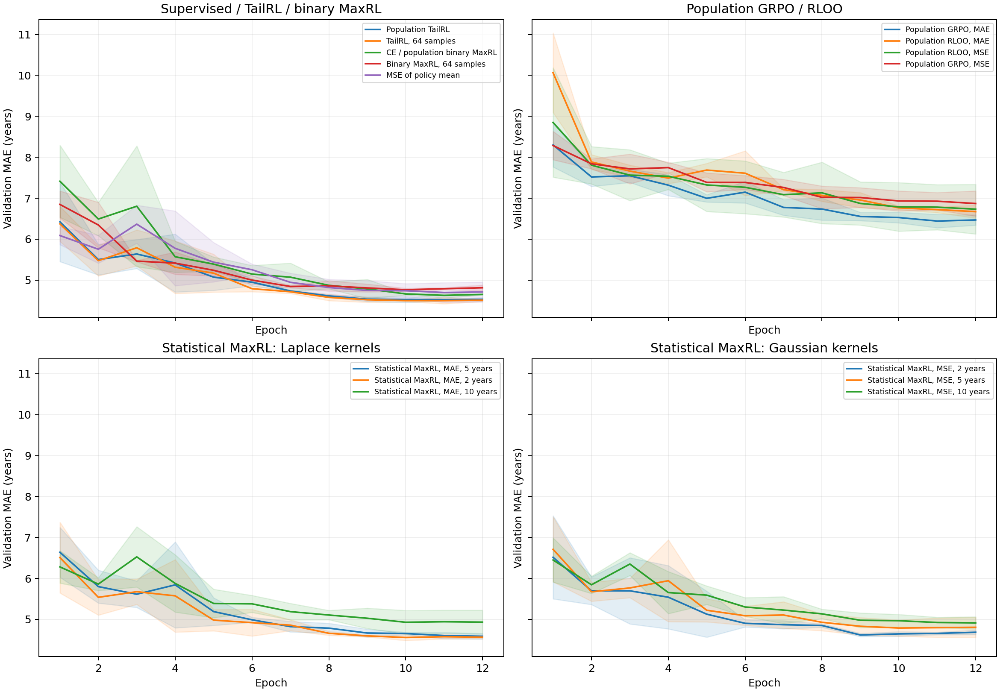

# UTKFace experiment results

Population TailRL achieved the lowest test MAE in this experiment: **4.574 ± 0.013 years**, compared with **4.699 ± 0.064** for CE and **4.807 ± 0.223** for MSE of the policy mean. Sampled TailRL with 64 draws achieved **4.599 ± 0.076**. These are means and sample standard deviations over three training seeds on one fixed data split, with a 12-epoch training budget.

The complete 15-configuration tables, including every Gaussian and Laplace scale, are in [measured metrics](results/metrics.md). [Per-seed results](results/runs.csv), [aggregate results](results/summary.csv), [full metrics and configurations](results/results.json), and [learning curves](results/learning_curves.csv) retain the measurements behind the tables. The [implementation guide](README.md) gives loss definitions, code locations and commands; [source provenance](SOURCES.md) records the original task and estimator code.

Every method uses the same ImageNet-pretrained ResNet-18, with a 512-to-100 linear head representing integer ages 0–99. All 11,227,812 parameters are trainable. The original task's 224px transforms, filename filtering and decade-stratified 80/10/10 split are retained. There are 18,936 training, 2,367 validation and 2,368 test images. The constant training-median predictor has test MAE 14.807 years.

The validation-only pilot ran 45 jobs: three learning rates (1e-4, 3e-4, 1e-3) for each of 15 objective/scale configurations, using 4,096 training and 512 validation images for three epochs. Each configuration retained its own best learning rate. All six Statistical MaxRL kernel configurations were retained for the main study. [Pilot measurements](results/pilot.csv), [full pilot configurations](results/pilot_results.json) and [selected learning rates](results/selection.json) are saved. CE and population RLOO-MAE selected 1e-3; all other configurations selected 3e-4. Kernel scales are 2, 5 and 10 years.

The main study completed **45 full-data runs**: 15 configurations × seeds 42, 43 and 44, each for 12 epochs. AdamW uses weight decay 1e-4, global batch 64, gradient clipping at norm 5, and cosine decay with 5% warmup and a 0.1 minimum LR ratio. CNN execution uses bf16 and probability calculations use float32. All objectives select their checkpoint by validation MAE of the policy mean; test metrics are computed only after selection. Training drops incomplete batches, giving 18,880 image presentations per epoch and 10,195,200 across the primary runs. Evaluation includes every example. Test results did not guide the learning-rate selection or subsequent training.

The primary runs used one L40 GPU each, scheduled across four available GPUs. Their recorded training/validation time totals 3.313 GPU-hours; the pilot totals another 0.270 GPU-hours. These counters exclude setup, queueing, final test scoring and diagnostics. The environment was Python 3.12.13, PyTorch 2.11.0+cu130 and torchvision 0.26.0+cu130. The training implementation was fixed at commit `3dfeb42`; later commits during the sweep added analysis, auditing and verification tools without changing model or training behavior. Each run records its actual checkout commit and data fingerprint.

Population TailRL improved on CE by 0.125 years on average (2.7%). Its improvement was positive for each matched seed: 0.110, 0.201 and 0.064 years. Three seeds and one split are insufficient for a broad claim of superiority. The 12-epoch budget and short pilot also limit conclusions about other objectives' best achievable performance. Several GRPO/RLOO and Statistical MaxRL runs selected their final epoch, so longer training could change the comparison.

Population Statistical MaxRL with a Laplace scale of 5 years achieved 4.706 ± 0.071 MAE; Laplace scale 2 achieved 4.718 ± 0.057, and Gaussian scale 2 achieved 4.725 ± 0.047. Scales of 10 performed worse, around 5.04–5.06 MAE, and produced low-entropy policies. This is an observed sensitivity to the kernel, rather than evidence that one scale is generally optimal.

Population GRPO and RLOO achieved MAEs of 6.48–6.87 years and mean categorical entropies of 0.05–0.10 nats. Their expected-reward objectives strongly concentrate probability on a single action. The observed concentration and larger errors are consistent with premature policy collapse, but these measurements do not establish that collapse is the only cause of the gap. No entropy regularizer was added to change the requested objectives.

MSE of the policy mean differs materially from expected action MSE: a wide or multimodal policy can have a correct mean. Its mean-prediction MAE was 4.807 years while its expected single-draw MAE was 11.729. Population TailRL's corresponding errors were 4.574 and 5.462; CE's were 4.699 and 6.000. The distribution table also reports categorical NLL, entropy and exact oracle best-of-64 error. The oracle uses the target to choose a draw and is a diagnostic, not an inference-time prediction rule.

The objectives trade off different distribution properties. CE had slightly lower categorical NLL than population TailRL (3.04 versus 3.06 nats), and lower oracle best-of-64 MAE (0.40 versus 0.54 years). Sampled TailRL was close to its population version on mean-prediction MAE, but had substantially higher categorical NLL (5.01 nats). Point accuracy alone would obscure that difference.

Population zero-one MaxRL is mathematically identical to CE, so the CE arm covers both. The separate 64-draw binary MaxRL arm achieved 4.780 ± 0.073 MAE. With target probability p and N draws, its expected gradient is the CE gradient multiplied by `1 - (1 - p) ** (N - 1)`. This changes the relative weighting of images. In the saved categorical [estimator diagnostic](results/estimators.csv), the 64-draw measured norm ratio was 0.268, compared with theoretical attenuation 0.264. At 4,096 draws, all four estimators had gradient cosine similarity above 0.999996 to their population references. The diagnostic uses one fixed synthetic categorical policy and 2,048 independent groups per rollout count; it is not a neural-network convergence guarantee.

The [data audit](results/data_audit.json) found **374 exact duplicate groups**, involving 763 images; 134 groups cross the original splits, and 204 duplicate groups have conflicting age labels. Byte hashes and decoded-RGB hashes gave the same counts. One identical image is labeled both age 10 and age 31. This affects interpretation of the original benchmark.

Checkpoint scoring additionally evaluates the 2,288 test images whose decoded pixels are unique across the entire dataset, without retraining or selecting new checkpoints. The original split remains the primary comparison. This singleton slice removes exact-image overlap, but does not establish person-level independence, remove near-duplicates, or repair conflicting training labels. Macro-decade MAE is included because the original test set contains 735 images aged 20–29 but only 13 aged 90–99; subgroup estimates at the oldest ages are correspondingly uncertain.

Population TailRL also led on the singleton slice (4.53 ± 0.02 years, compared with CE's 4.66 ± 0.06) and macro-decade MAE (5.54 ± 0.08, compared with CE's 5.83 ± 0.10). Every primary checkpoint was reloaded and rescored successfully; the difference from its original bf16 test MAE was below 0.000221 years for every run.

Two additional full-data, 12-epoch runs verified actual bf16 DDP training with NCCL and SyncBatchNorm. Each used two L40 GPUs, seed 42, 32 images per rank and global batch 64, with the previously selected learning rate. Both selected epoch 11, trained on 18,880 images per epoch, and evaluated all 2,367 validation and 2,368 test examples. These are implementation checks with one seed each and are kept separate from the primary three-seed aggregates; rank-specific augmentation streams differ from single-GPU training.

| Two-GPU check | Test MAE, years | Singleton test MAE, years | Recorded training/validation seconds |
|---|---:|---:|---:|
| CE | 4.672 | 4.640 | 244.8 |
| Population TailRL | 4.510 | 4.461 | 252.9 |

[Full DDP configurations, histories and checkpoint scores](results/ddp_full_runs.json) are saved. Checkpoint restoration differences were below 0.000017 years. These runs verify end-to-end behavior; they are not a controlled scaling benchmark. FSDP is not implemented.

The targeted suite passed **45 tests**: 33 new UTKFace checks and 12 existing MaxRL checks. It verifies exact population gradients against independent score-function or posterior formulas, stable extreme-logit behavior, TailRL threshold gradients, finite-sample binary bias, batched estimators, splits and architecture. Added Python files pass Ruff. Two-GPU gradient probes verified a linear model (maximum absolute difference 5.55e-17) and the full ResNet with SyncBatchNorm across all nine distinct population objectives (maximum relative error 5.58e-15). These numerical reference probes use float64; training uses bf16. Additional real-image smokes check uneven rank evaluation, deterministic CUDA execution, and deferred/limited test scoring. [Validation record](results/validation.json) and [per-objective distributed gradient measurements](results/ddp_gradients.json) are included.

Repository-wide lint still reports 19 existing errors in unrelated files. The existing corpus orchestrator suite has nine failures from tests targeting an older API. Those files were unchanged by this experiment; the targeted UTKFace and existing MaxRL suite passes.

All Python execution, tests and experiments ran through `uv` on `cmu-L40-live`, following `server.md`; code synchronization used local commits, GitHub pushes and remote pulls. Data and checkpoints are retained under `/home/zitongw2/.local/state/maxrl-statistics/`, in `utkface-data`, `utkface-main` and `utkface-ddp-checks`. Their historical `/tmp` paths remain symlinks after the SHA-256-verified migration on 2026-10-22. Compact result files and PNG/PDF figures are versioned here; this repository does not contain dataset images or model weights.
