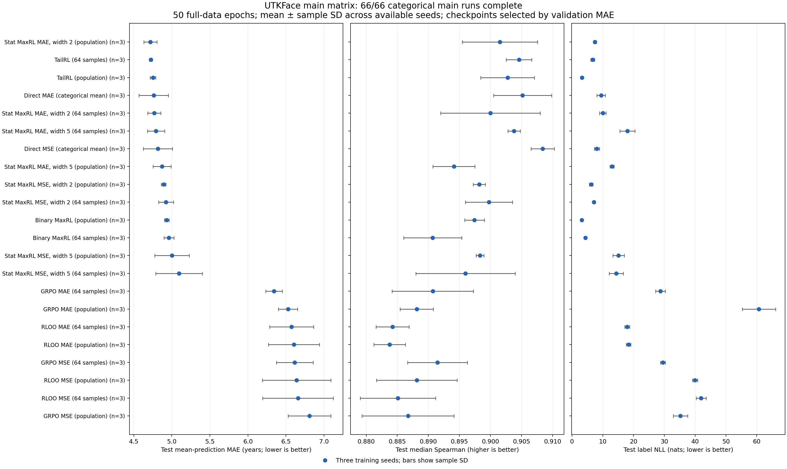

# Scaled UTKFace study

State: **running**. GPU time: **46.89 / 64 hours**. Completed primary runs: **66 / 66**.

Metrics use clean held-out labels. All tuning and scalar-head gates use validation data. Values are means ± sample SD across distinct training seeds; single-seed values have no SD. Label NLL is unavailable for scalar heads. Population zero-one MaxRL equals CE. Training subsets are fixed and nested.

| Noise mode | Requested SD, years | Realized RMSE, years | Realized SNR, dB |
|---|---:|---:|---:|
| fixed | 1 | 1.027 | 25.66 |
| fixed | 3 | 2.957 | 16.48 |
| fixed | 5 | 4.875 | 12.13 |
| fixed | 10 | 9.632 | 6.22 |
| fresh | 1 | 1.033 | 25.61 |
| fresh | 3 | 2.956 | 16.48 |
| fresh | 5 | 4.883 | 12.12 |
| fresh | 10 | 9.617 | 6.23 |

These are precomputed perturbation statistics for the fixed 4,096-image subset; fresh-noise values combine all 50 epochs. They are independent of model outcomes. [Noise design data](noise_design.json).

| Stage | Variant | Training size | Noise | Seeds | Mean MAE ↓ | Median MAE ↓ | Median Spearman ↑ | Label NLL ↓ |
|---|---|---:|---|---:|---:|---:|---:|---:|
| digits | mse_digits | 4096 | none 0 | 1 | 5.200 | 5.650 | 0.885 | 4.608 |
| digits | tailrl_population_digits | 4096 | none 0 | 1 | 5.376 | 5.435 | 0.884 | 3.650 |
| digits | ce_digits | 4096 | none 0 | 1 | 5.907 | 6.065 | 0.867 | 3.288 |
| flat | mse | 4096 | none 0 | 1 | 5.169 | 5.536 | 0.884 | 5.003 |
| flat | mae_scalar | 4096 | none 0 | 1 | 5.321 | 5.321 | 0.889 | n/a |
| flat | mse_scalar | 4096 | none 0 | 1 | 5.326 | 5.326 | 0.895 | n/a |
| flat | mae | 4096 | none 0 | 1 | 5.561 | 5.671 | 0.881 | 6.773 |
| flat | tailrl_population | 4096 | none 0 | 1 | 5.573 | 5.592 | 0.875 | 3.525 |
| flat | ce | 4096 | none 0 | 1 | 5.934 | 6.063 | 0.864 | 3.721 |
| main | stat_maxrl_mae_population_s2 | full | none 0 | 3 | 4.718 ± 0.086 | 4.828 ± 0.120 | 0.902 ± 0.006 | 7.439 ± 0.451 |
| main | tailrl | full | none 0 | 3 | 4.724 ± 0.019 | 4.765 ± 0.020 | 0.905 ± 0.002 | 6.698 ± 0.626 |
| main | tailrl_population | full | none 0 | 3 | 4.752 ± 0.037 | 4.730 ± 0.081 | 0.903 ± 0.004 | 3.214 ± 0.222 |
| main | mae | full | none 0 | 3 | 4.762 ± 0.193 | 4.905 ± 0.197 | 0.905 ± 0.005 | 9.451 ± 1.390 |
| main | stat_maxrl_mae_s2 | full | none 0 | 3 | 4.769 ± 0.086 | 4.871 ± 0.088 | 0.900 ± 0.008 | 10.010 ± 1.083 |
| main | stat_maxrl_mae_s5 | full | none 0 | 3 | 4.793 ± 0.113 | 4.859 ± 0.106 | 0.904 ± 0.001 | 18.014 ± 2.437 |
| main | mse | full | none 0 | 3 | 4.817 ± 0.191 | 4.956 ± 0.179 | 0.908 ± 0.002 | 8.099 ± 0.864 |
| main | stat_maxrl_mae_population_s5 | full | none 0 | 3 | 4.871 ± 0.118 | 5.028 ± 0.127 | 0.894 ± 0.003 | 13.023 ± 0.674 |
| main | stat_maxrl_mse_population_s2 | full | none 0 | 3 | 4.892 ± 0.031 | 5.024 ± 0.029 | 0.898 ± 0.001 | 6.234 ± 0.592 |
| main | stat_maxrl_mse_s2 | full | none 0 | 3 | 4.923 ± 0.096 | 5.026 ± 0.073 | 0.900 ± 0.004 | 7.150 ± 0.318 |
| main | binary_maxrl_population | full | none 0 | 3 | 4.933 ± 0.030 | 4.969 ± 0.024 | 0.897 ± 0.002 | 3.195 ± 0.124 |
| main | binary_maxrl | full | none 0 | 3 | 4.961 ± 0.065 | 5.070 ± 0.102 | 0.891 ± 0.005 | 4.387 ± 0.288 |
| main | stat_maxrl_mse_population_s5 | full | none 0 | 3 | 5.002 ± 0.228 | 5.096 ± 0.217 | 0.898 ± 0.001 | 15.107 ± 1.851 |
| main | stat_maxrl_mse_s5 | full | none 0 | 3 | 5.095 ± 0.306 | 5.303 ± 0.284 | 0.896 ± 0.008 | 14.354 ± 2.295 |
| main | grpo_mae | full | none 0 | 3 | 6.342 ± 0.109 | 6.409 ± 0.099 | 0.891 ± 0.007 | 28.755 ± 1.572 |
| main | grpo_mae_population | full | none 0 | 3 | 6.526 ± 0.126 | 6.559 ± 0.136 | 0.888 ± 0.003 | 60.694 ± 5.382 |
| main | rloo_mae | full | none 0 | 3 | 6.573 ± 0.288 | 6.720 ± 0.318 | 0.884 ± 0.003 | 17.929 ± 0.795 |
| main | rloo_mae_population | full | none 0 | 3 | 6.603 ± 0.336 | 6.746 ± 0.337 | 0.884 ± 0.003 | 18.375 ± 0.743 |
| main | grpo_mse | full | none 0 | 3 | 6.614 ± 0.242 | 6.677 ± 0.243 | 0.891 ± 0.005 | 29.489 ± 0.792 |
| main | rloo_mse_population | full | none 0 | 3 | 6.640 ± 0.450 | 6.702 ± 0.465 | 0.888 ± 0.006 | 39.942 ± 0.837 |
| main | rloo_mse | full | none 0 | 3 | 6.657 ± 0.465 | 6.734 ± 0.476 | 0.885 ± 0.006 | 41.929 ± 1.607 |
| main | grpo_mse_population | full | none 0 | 3 | 6.808 ± 0.281 | 6.881 ± 0.279 | 0.887 ± 0.007 | 35.231 ± 2.314 |
| noise | mae_scalar | 4096 | fixed 1 | 1 | 5.198 | 5.198 | 0.889 | n/a |
| noise | ce | 4096 | fixed 1 | 1 | 5.887 | 6.032 | 0.863 | 3.745 |
| noise | tailrl_population | 4096 | fresh 5 | 1 | 5.215 | 5.228 | 0.888 | 3.330 |
| noise | mse | 4096 | fresh 5 | 1 | 5.231 | 5.416 | 0.888 | 5.209 |
| noise | mae_scalar | 4096 | fresh 5 | 1 | 5.262 | 5.262 | 0.895 | n/a |
| noise | ce | 4096 | fresh 5 | 1 | 5.439 | 5.421 | 0.881 | 3.375 |
| noise | mse_scalar | 4096 | fresh 5 | 1 | 5.489 | 5.489 | 0.889 | n/a |
| noise | mse | 4096 | fixed 5 | 1 | 5.588 | 5.718 | 0.873 | 5.003 |
| noise | mae | 4096 | fresh 5 | 1 | 5.609 | 5.741 | 0.876 | 8.033 |
| noise | mse_scalar | 4096 | fixed 5 | 1 | 5.741 | 5.741 | 0.877 | n/a |
| noise | mae_scalar | 4096 | fixed 5 | 1 | 5.764 | 5.764 | 0.874 | n/a |
| noise | mae | 4096 | fixed 5 | 1 | 5.896 | 6.093 | 0.860 | 11.393 |
| noise | tailrl_population | 4096 | fixed 5 | 1 | 5.967 | 6.014 | 0.859 | 3.589 |
| noise | ce | 4096 | fixed 5 | 1 | 6.312 | 6.455 | 0.854 | 3.609 |
| scalar | mae_scalar | full | none 0 | 1 | 4.611 | 4.611 | 0.911 | n/a |
| scalar | mse_scalar | full | none 0 | 1 | 4.680 | 4.680 | 0.912 | n/a |
| subset | mae_scalar | 4096 | none 0 | 1 | 5.145 | 5.145 | 0.899 | n/a |
| subset | mse | 4096 | none 0 | 1 | 5.216 | 5.392 | 0.890 | 5.371 |
| subset | mse_scalar | 4096 | none 0 | 1 | 5.314 | 5.314 | 0.892 | n/a |
| subset | tailrl_population | 4096 | none 0 | 1 | 5.406 | 5.646 | 0.866 | 4.260 |
| subset | mae | 4096 | none 0 | 1 | 5.576 | 5.901 | 0.868 | 9.432 |
| subset | ce | 4096 | none 0 | 1 | 6.097 | 6.273 | 0.856 | 3.583 |

GPU time charges every launched attempt, including failures, retries, process startup, final test evaluation and polling overhead. Waiting for free GPUs consumes no GPU budget. Optional studies start after required studies finish. SNR is 10 log10(variance of clean subset ages / mean squared realized label perturbation), after rounding and clipping. Clean-label SNR is infinite and stored as null.

[Machine-readable progress](progress.json).

[Per-run values and LR tuning](runs.csv). [Full configs and metrics](results.json). [Epoch curves and realized noise statistics](curves.csv).
