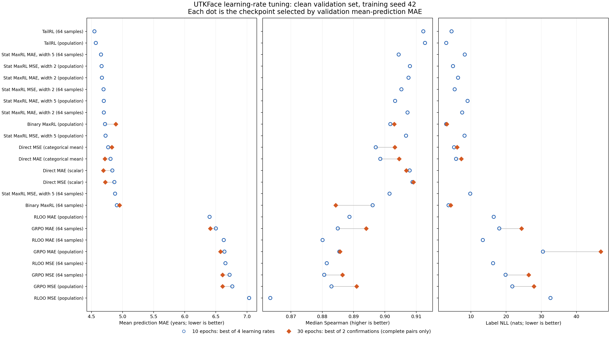

# Learning-rate tuning results, 2026-10-13

The report snapshot at 21:09 Asia/Shanghai has **96/96 initial learning-rate pilots**, **20/48 longer confirmations**, and **0/66 main runs** complete. Ten configurations have finished both 30-epoch confirmations. Two population RLOO-MAE confirmations are running. Charged allocation is **13.337/64 GPU-hours**; there are no permanently failed jobs. Smaller-subset, constant-LR, label-noise and digit-policy training results are still pending.

These are **single-seed validation tuning results**, not the requested three-seed, 50-epoch test comparison. Each run uses training seed 42, the same 18,462-image training pool and 2,308 clean validation images. Each epoch presents 18,432 training images. Neither tuning stage evaluates the test split. All reported metrics come from the checkpoint selected by validation mean-prediction MAE.

The figure shows the best of four rates after ten epochs and, where both confirmations are complete, the best of two rates after thirty epochs. Lines connect separately trained runs; they are not a single run's learning curve. There are no seed uncertainty estimates yet. [PDF figure](pilots.pdf).

## Completed 30-epoch confirmations

| Method | LR | Best epoch | Mean MAE, years | Median Spearman | Label NLL, nats | Entropy, nats |
|---|---:|---:|---:|---:|---:|---:|
| Direct MAE, scalar head | 0.001 | 30 | 4.690 | 0.9068 | n/a | n/a |
| Direct MAE, categorical mean | 0.001 | 27 | 4.714 | 0.9045 | 7.301 | 1.951 |
| Direct MSE, scalar head | 0.001 | 25 | 4.722 | 0.9091 | n/a | n/a |
| Direct MSE, categorical mean | 0.001 | 27 | 4.827 | 0.9031 | 6.130 | 2.259 |
| Population binary MaxRL (CE) | 0.003 | 20 | 4.890 | 0.9030 | 3.172 | 2.418 |
| 64-sample binary MaxRL | 0.001 | 21 | 4.951 | 0.8843 | 4.278 | 1.812 |
| 64-sample GRPO, MAE reward | 0.0003 | 25 | 6.410 | 0.8940 | 24.424 | 0.098 |
| Population GRPO, MAE reward | 0.001 | 29 | 6.575 | 0.8857 | 46.938 | 0.056 |
| 64-sample GRPO, MSE reward | 0.0003 | 26 | 6.606 | 0.8865 | 26.443 | 0.056 |
| Population GRPO, MSE reward | 0.0003 | 29 | 6.606 | 0.8910 | 27.935 | 0.052 |

Scalar MAE passes the planned competitiveness gate: its validation MAE is 0.9948 times the categorical counterpart, below the 1.05 threshold. It therefore qualifies for the three-seed full-data runs and the later reduced studies. Its 0.024-year point advantage is too small to establish superiority from one tuning seed. Scalar MSE also passes the gate: its 4.722-year MAE is 0.9781 times the 4.827-year categorical counterpart, qualifying it for the same later studies. Scalar Spearman ranks the continuous prediction; categorical Spearman ranks the policy median, so their tie patterns differ. Scalar label NLL and entropy are unavailable.

GRPO still has substantially higher point error than the completed direct-loss and binary-MaxRL confirmations, alongside very low entropy and high label NLL. This supports investigating distribution concentration; it does not identify the cause or establish that every policy-gradient configuration must behave similarly. CE has the lowest label NLL among the completed confirmation winners. MAE and NLL reward different behavior, so point-error rankings alone do not describe the learned distribution.

Some 30-epoch winners have higher validation MAE than their ten-epoch pilot counterparts. The runs restart from scratch with a schedule tied to their own horizon, including different warmup and decay timing. These are separate trajectories; the comparison does not show that simply continuing the ten-epoch checkpoint worsens it.

## Completed 10-epoch sweep

All 24 configurations finished all four rates. The table shows each grid's lowest validation mean-prediction MAE.

| Method | LR | Best epoch | Mean MAE, years | Median Spearman | Label NLL, nats | Entropy, nats |
|---|---:|---:|---:|---:|---:|---:|
| 64-sample TailRL | 0.0003 | 10 | 4.548 | 0.9123 | 4.526 | 2.182 |
| Population TailRL | 0.0003 | 9 | 4.570 | 0.9128 | 3.020 | 2.479 |
| 64-sample Statistical MaxRL, MAE width 5 | 0.0003 | 9 | 4.654 | 0.9044 | 8.281 | 0.795 |
| Population Statistical MaxRL, MSE width 2 | 0.001 | 9 | 4.663 | 0.9080 | 4.937 | 1.905 |
| Population Statistical MaxRL, MAE width 2 | 0.001 | 9 | 4.668 | 0.9075 | 6.372 | 1.374 |
| 64-sample Statistical MaxRL, MSE width 2 | 0.0003 | 8 | 4.695 | 0.9053 | 5.414 | 1.749 |
| Population Statistical MaxRL, MAE width 5 | 0.001 | 9 | 4.698 | 0.9032 | 9.080 | 0.914 |
| 64-sample Statistical MaxRL, MAE width 2 | 0.001 | 9 | 4.699 | 0.9072 | 7.544 | 1.302 |
| Population binary MaxRL (CE) | 0.001 | 9 | 4.718 | 0.9017 | 2.998 | 2.471 |
| Population Statistical MaxRL, MSE width 5 | 0.001 | 9 | 4.727 | 0.9067 | 8.217 | 1.425 |
| Direct MSE, categorical mean | 0.0003 | 10 | 4.769 | 0.8971 | 5.237 | 2.815 |
| Direct MAE, categorical mean | 0.0003 | 10 | 4.807 | 0.8985 | 5.817 | 2.336 |
| Direct MAE, scalar head | 0.0003 | 10 | 4.836 | 0.9079 | n/a | n/a |
| Direct MSE, scalar head | 0.001 | 10 | 4.868 | 0.9088 | n/a | n/a |
| 64-sample Statistical MaxRL, MSE width 5 | 0.0003 | 10 | 4.880 | 0.9015 | 9.837 | 0.750 |
| 64-sample binary MaxRL | 0.0003 | 10 | 4.909 | 0.8961 | 3.674 | 2.148 |
| Population RLOO, MAE reward | 0.0003 | 10 | 6.399 | 0.8887 | 16.505 | 0.127 |
| 64-sample GRPO, MAE reward | 0.0003 | 9 | 6.501 | 0.8850 | 18.081 | 0.094 |
| 64-sample RLOO, MAE reward | 0.0001 | 10 | 6.627 | 0.8801 | 13.411 | 0.127 |
| Population GRPO, MAE reward | 0.001 | 10 | 6.638 | 0.8855 | 30.485 | 0.090 |
| 64-sample RLOO, MSE reward | 0.0003 | 10 | 6.654 | 0.8814 | 16.321 | 0.096 |
| 64-sample GRPO, MSE reward | 0.0003 | 10 | 6.721 | 0.8806 | 19.872 | 0.086 |
| Population GRPO, MSE reward | 0.0003 | 10 | 6.765 | 0.8829 | 21.789 | 0.056 |
| Population RLOO, MSE reward | 0.003 | 10 | 7.035 | 0.8634 | 32.629 | 0.121 |

TailRL has the lowest point error in this initial sweep. The sampled estimator's 0.022-year advantage over the population estimator is small and accompanies higher label NLL. Statistical MaxRL also has competitive point error but higher NLL than CE. TailRL, Statistical MaxRL and RLOO still need their longer confirmations before the 50-epoch comparison; these early rankings are not final conclusions.

## Integrity and remaining work

The 21:09 integrity check verified the immutable plan, all eleven frozen training-source hashes, the cleaned manifest, the common training fingerprint and nested 4096/1024 subsets. All 96 pilots and 20 confirmations finished their planned epoch counts with finite losses, gradient norms and distribution metrics; their saved checkpoints match the lowest validation MAE. Every confirmation used the intended validation-ranked pilot learning rate. Scalar NLL is unavailable as intended. Artifact-only Git revisions differ across runs, while the frozen training implementation is identical. [Integrity checks and tuning decisions](pilot_integrity.json).

All four real-image bf16 preflights passed: sampled Statistical MaxRL with MAE/MSE kernels, scalar MAE, and the conditional digit policy with CE. Each trained on 256 images and evaluated 65 validation and 65 test images. These are pipeline checks, not method-comparison results. [Preflight validation](preflight_validation.json).

The supervisor remains PID 1425732 on cmu-L40-live. Observed peak study concurrency is three GPUs, below the six-GPU cap. Another workload interrupted a direct-MSE confirmation on GPU 9; the scheduler yielded and retried it successfully, preserving every attempt's charge. Earlier preemption recovery is documented in the [recovery record](queue_recovery.json). Genuine training failures still halt dispatch. Waiting for idle GPUs consumes no GPU allocation. The server's /tmp currently has about 24 GB free.

Noise design is measured, but no label-noise training comparison has completed. On the fixed 4096-image subset, rounded and clipped Gaussian perturbations with requested standard deviations 1/3/5 years have fixed-noise SNRs 25.66/16.48/12.13 dB and fresh-noise SNRs 25.61/16.48/12.12 dB averaged over fifty epochs. [Noise design](noise_design.json).

The queue continues the remaining confirmations, then the 66 categorical main runs, gated scalar runs, fixed-subset studies, constant-LR sweeps and required noise studies within the 64 GPU-hour allocation. Optional digit policies and extra noise runs follow required work. State, process ownership, attempts, logs and budget accounting remain under /tmp/utkface-study-20261013/; the plan and previous attempts have not been replaced.

[Per-run records](runs.csv), [full validation metrics and configs](results.json), [epoch curves](curves.csv), [machine-readable progress](progress.json), [generated interim report](REPORT.md), [protocol](PLAN.md), [frozen execution metadata](execution.json), and [validation record](validation.json). The hourly follow-up remains active, and the server queue runs independently of the desktop app.
