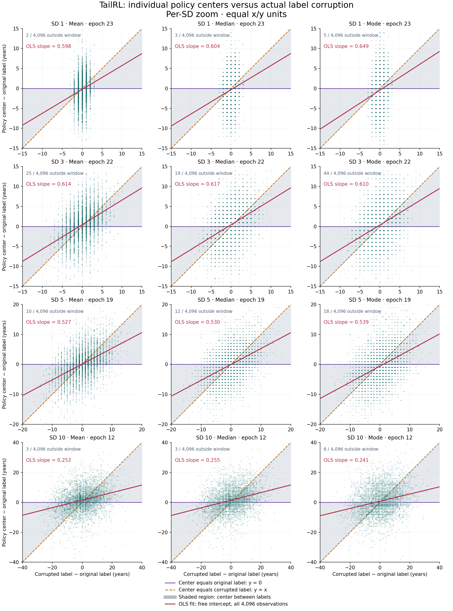

## Task and examples

Given a cropped face image $x$, predict its annotated integer age $y\in\{0,\ldots,99\}$. The cleaned UTKFace split contains **18,462 training / 2,308 validation / 2,308 test** images, stratified by age decade. Exact RGB duplicates are removed before splitting; identities and near-duplicates are not controlled.

::: {.utk-examples}
<figure><figcaption>Age 1</figcaption></figure>
<figure><figcaption>Age 8</figcaption></figure>
<figure><figcaption>Age 16</figcaption></figure>
<figure><figcaption>Age 25</figcaption></figure>
<figure><figcaption>Age 35</figcaption></figure>
<figure><figcaption>Age 50</figcaption></figure>
<figure><figcaption>Age 65</figcaption></figure>
<figure><figcaption>Age 85</figcaption></figure>
:::

Eight illustrative training images; the captions are dataset labels. [Example provenance](utkface/examples.json).

## Models and training

All models **fully fine-tune ImageNet-pretrained ResNet-18**, including its backbone. Inputs are $224\times224$ RGB crops with ImageNet normalization; training adds random crops, horizontal flips and color jitter.

::: {.utk-table}

| Component | Setting |
|---|---|
| Categorical policy | Linear 100-logit head, $\pi_\theta(a\mid x)=\operatorname{softmax}(z_\theta(x))_a$ |
| Scalar regression | One linear output, $\hat y=99\,\operatorname{sigmoid}(z_\theta(x))$ |
| Two-digit policy | $\pi(t,u\mid x)=\pi(t\mid x)\pi(u\mid x,t)$; 10-way tens head and a conditional units head, evaluated over all 100 joint ages |
| Optimization | AdamW; **batch size 64**; weight decay $10^{-4}$; gradient clipping at 5; bfloat16 backbone execution |
| Schedule | 5% linear warmup, then cosine decay to 10% of the peak learning rate |
| Usual budget | 50 epochs; full-data comparisons use matched seeds 42/43/44. Exceptions are stated below. |

:::

Checkpoints minimize clean validation **mean-age MAE**. All reported metrics, including greedy decoding, use the same selected checkpoint.

Learning rates for all methods

::: {.utk-table}

| Method | Full data | 1,024 images | 4,096 images / noisy labels | Two-digit head |
|--------------------------------|----------:|----------:|----------------:|------------:|
| CE / population binary MaxRL | $10^{-3}$ | $10^{-3}$ | $10^{-3}$ | $10^{-3}$ |
| Sampled binary MaxRL | $10^{-3}$ | — | — | — |
| Categorical MAE | $10^{-3}$ | $10^{-3}$ | $10^{-3}$ | $3\times10^{-4}$ |
| Categorical MSE | $10^{-3}$ | $10^{-3}$ | $10^{-3}$ | $10^{-3}$ |
| Scalar MAE / MSE | $10^{-3}$ | $10^{-3}$ | $10^{-3}$ | — |
| Population TailRL | $10^{-3}$ | $10^{-3}$ | $10^{-3}$ | $10^{-3}$ |
| Sampled TailRL | $10^{-3}$ | — | — | — |
| Population statistical MAE | $10^{-3}$ | $10^{-3}$ | $10^{-3}$ | $10^{-3}$ |
| Sampled statistical MAE | $10^{-3}$ | — | — | — |
| Population statistical MSE | $3\times10^{-4}$ | $10^{-3}$ | $10^{-3}$ | $10^{-3}$ |
| Sampled statistical MSE | $3\times10^{-4}$ | — | — | — |
| Population GRPO MAE | $3\times10^{-4}$ | $3\times10^{-4}$ | $10^{-3}$ | $3\times10^{-4}$ |
| Sampled GRPO MAE | $3\times10^{-4}$ | — | — | — |
| Population GRPO MSE | $3\times10^{-4}$ | $3\times10^{-4}$ | $3\times10^{-4}$ | $3\times10^{-4}$ |
| Sampled GRPO MSE | $3\times10^{-4}$ | — | — | — |
| Population RLOO MAE | $10^{-4}$ | — | — | — |
| Sampled RLOO MAE | $10^{-4}$ | — | — | — |
| Population RLOO MSE | $10^{-3}$ | — | — | — |
| Sampled RLOO MSE | $10^{-3}$ | — | — | — |

:::

These are peak rates for the cosine schedule. The two-digit rates apply to both full data and 4,096 images. Full-data statistical MaxRL uses widths 2 and 5; subset and two-digit arms use width 2. Sampled estimators use 64 actions per image. Dashes indicate unrun settings; the 1,024-image scalar runs use 50 epochs.

### Reported metrics

Write $\mu=\mathbb E_\pi[a]$, $m=\operatorname{median}_\pi(a)$ and $g=\arg\max_a\pi(a\mid x)$.

::: {.utk-table}

| Metric | Definition | Better |
|---|---|---|
| Mean-age MAE | $\mathbb E[|\mu-y|]$, in years | Lower |
| Mean-age RMSE | $\sqrt{\mathbb E[(\mu-y)^2]}$, in years | Lower |
| Median Spearman | Rank correlation between $m$ and $y$ | Higher |
| Label NLL | $\mathbb E[-\log\pi(y\mid x)]$, in nats | Lower |
| Mode MAE | $\mathbb E[|g-y|]$, in years | Lower |

:::

Scalar models use their continuous prediction for all point metrics and have no label NLL. Here **greedy decoding means the global mode over 100 ages**, including the joint two-digit policy; it is not successive greedy tens/units decoding.

## Methods

### TailRL

TailRL rewards probability mass inside **every age-error tolerance**, with a logarithmic penalty when a tolerance has little mass. For this discrete task its exact population loss is

::: {.utk-equation}

$$
\mathcal L_{\mathrm{TailRL}}(x,y)
=-\frac{1}{99}\sum_{d=0}^{98}
\log\!\left(\sum_{a:\,|a-y|\le d}\pi_\theta(a\mid x)\right).
$$

:::

The tightest window asks for the exact age; wider windows give credit for nearby ages. **Population TailRL** sums all 100 age probabilities exactly. **Sampled TailRL** draws 64 ages per image, assigns $r=1-|a-y|/99$, sorts the rewards, and accumulates reward gaps divided by their surviving sample counts. Centering these weights gives the detached advantages in $-\frac1{64}\sum_i A_i\log\pi_\theta(a_i\mid x)$. The survival floor is zero.

### Other objectives and rewards

- **Categorical SL:** CE fits the annotated age. Categorical MAE/MSE apply absolute/squared error to the **policy mean** $\mu$, rather than averaging the error of sampled ages.
- **Scalar SL:** MAE or MSE on the bounded continuous prediction. Regression losses normalize age errors by 99.
- **GRPO / RLOO:** policy gradients with within-image reward standardization / a leave-one-out reward baseline. The MAE reward is $1-|a-y|/99$; the MSE reward is $1-((a-y)/99)^2$. Population variants sum the policy exactly; sampled variants use 64 actions.
- **Statistical MaxRL:** maximize expected kernel reward through its logarithm: $-\log\mathbb E_\pi[k(a-y)]$. The retained comparisons use width 2 years, with $k(e)=e^{-|e|/2}$ for MAE or $k(e)=e^{-\frac12(e/2)^2}$ for MSE.

## Experiments

All plots show **validation curves**. Each pair opens independently: policy summaries on the left, mode MAE on the right. Default moving means span 5 epochs, or 10 for 200-epoch runs; bands show between-seed sample SD, not confidence intervals. Choose raw curves or the full axis range in each block. For the noise experiment, select an SD to inspect its four policy metrics; its greedy block shows all four SDs together.

The numerical notes below average each run's metrics at its **best mean-age-MAE checkpoint**, across the stated seeds. They do not independently select the best greedy checkpoint.

### 1. Full-data comparison

**Setting:** 18,462 training images, 50 epochs, three matched seeds; eight methods. GRPO and RLOO each use their best available configuration by mean best validation MAE: sampled GRPO-MAE and population RLOO-MAE.

::: {.column-page}

Policy summaries MAE · RMSE · Spearman · NLL

Greedy decoding Mode MAE

:::

**Finding:** Scalar MAE leads on validation mean-age MAE at **4.67 years**. Population TailRL follows at **4.73**, slightly ahead of sampled TailRL (**4.76**); their mode MAEs are nearly identical (**4.86 / 4.86**). Scalar MAE also has the lowest observed full-data test MAE across the evaluated configurations: **4.632 ± 0.023 years**. GRPO/RLOO perform substantially worse.

### 2. Scalar versus categorical supervision

**Setting:** Full data, 50 epochs, three matched seeds. Scalar and categorical heads each optimize direct MAE or MSE; all four use peak LR $10^{-3}$.

::: {.column-page}

Policy summaries MAE · RMSE · Spearman · NLL

Greedy decoding Mode MAE

:::

**Finding:** Scalar MAE (**4.67**) and scalar MSE (**4.77**) outperform categorical MAE (**4.86**) and MSE (**4.90**) on mean-age MAE. Switching to the categorical modes widens the gap: their MAEs are **5.30** and **5.60 years**.

### 3. Limited data, longer training

**Setting:** A fixed, decade-stratified subset of **1,024 images for 200 epochs**, seed 42. Eight completed categorical objectives are compared; scalar, sampled TailRL and RLOO runs are unavailable at this budget.

::: {.column-page}

Policy summaries MAE · RMSE · Spearman · NLL

Greedy decoding Mode MAE

:::

**Finding:** Categorical MSE leads on validation mean-age MAE at **6.08 years**, ahead of categorical MAE (**6.41**) and population TailRL (**6.62**). TailRL has the lowest validation mode MAE (**7.61**); categorical MAE reaches **7.65** and categorical MSE **8.15**. These are single-seed comparisons.

### 4. Sampled versus population TailRL

**Setting:** Full data, 50 epochs, three matched seeds; TailRL's two estimators versus scalar MAE and CE. All four use peak LR $10^{-3}$.

::: {.column-page}

Policy summaries MAE · RMSE · Spearman · NLL

Greedy decoding Mode MAE

:::

**Finding:** Both TailRL variants outperform CE. Population TailRL has slightly lower validation mean-age MAE (**4.73 vs 4.76**), while their validation mode MAEs nearly coincide (**4.864 vs 4.859**). Sampled TailRL has slightly lower test mean-age MAE (**4.724 vs 4.754**); their test mode MAEs are also close (**4.928 vs 4.922**). These small gaps do not establish an estimator winner; scalar MAE performs best here.

### 5. Fixed training-label noise

**Setting:** 4,096 images, 50 epochs, optimization seed 42. Add Gaussian label noise once per image with SD **1, 3, 5 or 10 years**, round and clip to 0–99; validation labels stay clean. All methods share noise seed 2026 and reuse their clean-subset learning rates. Plot labels use $\eta=\text{noise RMS}/\text{clean-age SD}$. The RL comparator is population GRPO-MAE; no RLOO noise arm was run.

::: {.column-page}

Policy summaries Four noise levels

Greedy decoding Mode MAE · four noise levels

:::

**Finding:** Among the five displayed methods, scalar MAE leads on validation mean-age MAE at all four noise levels. At SD 10, its MAE is **6.77 years**, compared with **6.97** for population TailRL. Scalar MAE also has the lowest mode MAE among the displayed methods.

Across all ten evaluated noise arms, categorical MSE and MAE have test mean-age MAEs of **6.252 / 6.396 years** at SD 10, with larger mode errors of **8.200 / 7.769 years**, respectively. These results do not establish a general TailRL robustness advantage. The noise comparison uses one optimization seed and one corruption field per noise level.

Example policy distributions Policy centers · images and labels · all 100 ages

<strong>Where are the TailRL policies centered?</strong> Each point below is one of the 4,096 training faces. Columns show the policy mean, median, and mode; rows show fixed noise SDs 1, 3, 5, and 10. The fitted trends show partial noise-following, with substantial variation across individual faces.

<figure class="utk-policy-centering" id="fig-utkface-policy-centering">

<figcaption>The horizontal axis is corrupted minus original label; the vertical axis is policy center minus original label, in years. Purple marks an original-label center, orange a corrupted-label center, and gray the interval between them. Red lines are ordinary least-squares fits with a free intercept; slopes use all 4,096 faces, including points outside the annotated zoom windows, without age adjustment. Each SD has its own range with equal x/y units. Checkpoints are selected by clean validation mean-age MAE (epochs 23, 22, 19, and 12). This is one optimization seed and one corruption field; original labels are UTKFace annotations. Click the image for full resolution. <a href="utkface/tailrl-policy-centering-scatter.json">Figure provenance and fit coefficients</a>.</figcaption>
</figure>
<table class="table table-sm utk-policy-correlations" id="tbl-utkface-policy-centering-pearson">
<caption>Pearson correlation between actual label corruption and policy-center error, using all 4,096 training faces, including points outside the zoom windows; no age adjustment.</caption>
<thead><tr><th scope="col">Noise SD</th><th scope="col">Policy mean</th><th scope="col">Policy median</th><th scope="col">Policy mode</th></tr></thead>
<tbody>
<tr><th scope="row">1</th><td>0.184</td><td>0.183</td><td>0.180</td></tr>
<tr><th scope="row">3</th><td>0.410</td><td>0.407</td><td>0.373</td></tr>
<tr><th scope="row">5</th><td>0.463</td><td>0.455</td><td>0.432</td></tr>
<tr><th scope="row">10</th><td>0.297</td><td>0.297</td><td>0.246</td></tr>
</tbody>
</table>

Compare population TailRL, CE, and population GRPO on the same 32 training and 16 held-out faces. Browse a batch or one face across fixed noise SDs 0, 1, 3, 5, and 10; SD 0 is the clean baseline. Checkpoints use clean validation mean-age MAE selection. <a href="utkface/policy-examples.html" target="_blank" rel="noopener">Open the full-size explorer</a>.

<iframe data-src="utkface/policy-examples.html" title="UTKFace policy distributions under fixed label noise" loading="lazy"></iframe>

### 6. Conditional two-digit policies

**Setting:** Full data, 50 epochs, seed 42; eight objectives on the conditional tens/units head. The objectives use the exact 100-age joint distribution. Learning rates are tuned on 4,096 images and reused on full data, so comparisons with the single-head architecture are exploratory.

::: {.column-page}

Policy summaries MAE · RMSE · Spearman · NLL

Greedy decoding Joint-mode MAE

:::

**Finding:** Direct MAE (**4.67**) and MSE (**4.73**) lead on mean-age MAE, followed by population TailRL (**4.78**). TailRL leads on joint-mode MAE at **4.88 years**; statistical MSE follows at **5.16**. The best objective therefore depends on the decoding rule.

[Plot data and run provenance](utkface/curves.js) · [Training implementation](/src/experiments/utkface/run.py) · [Data and method sources](/experiments/utkface/SOURCES.md)
